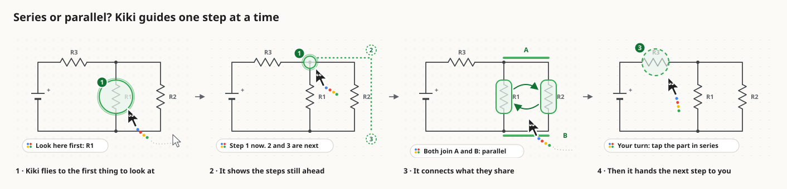
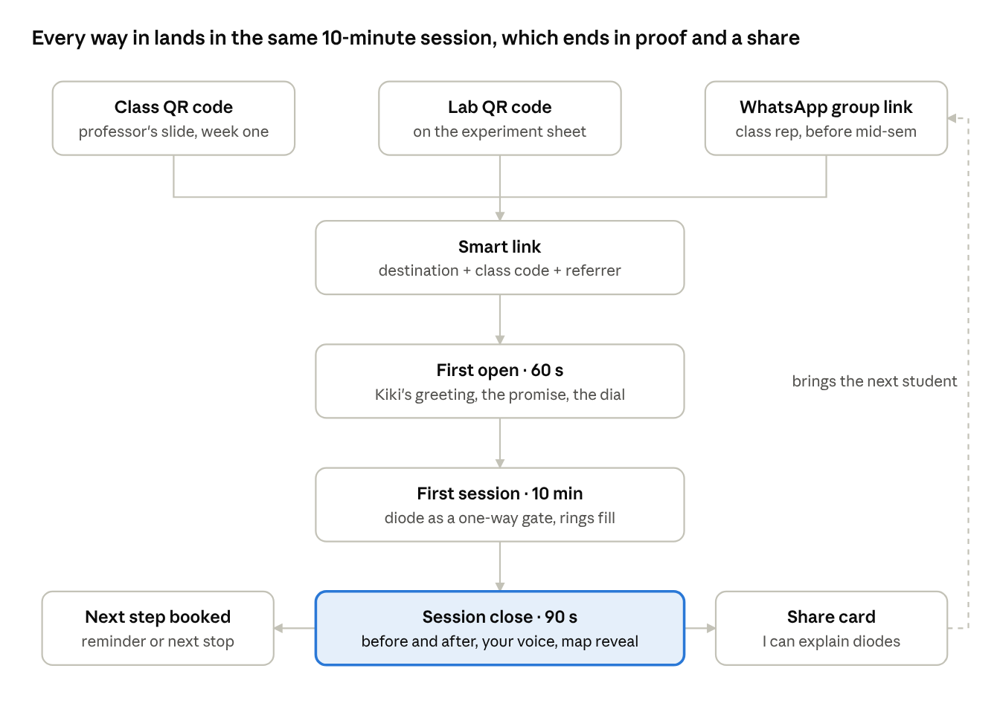
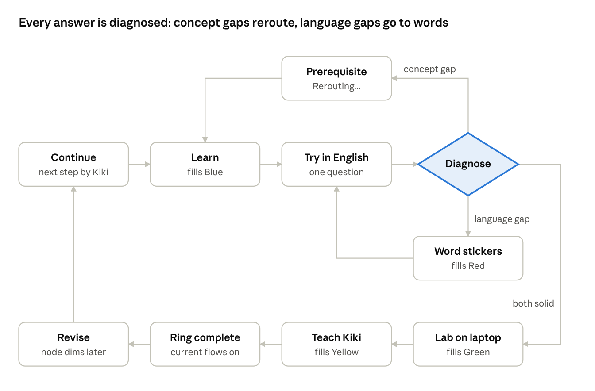
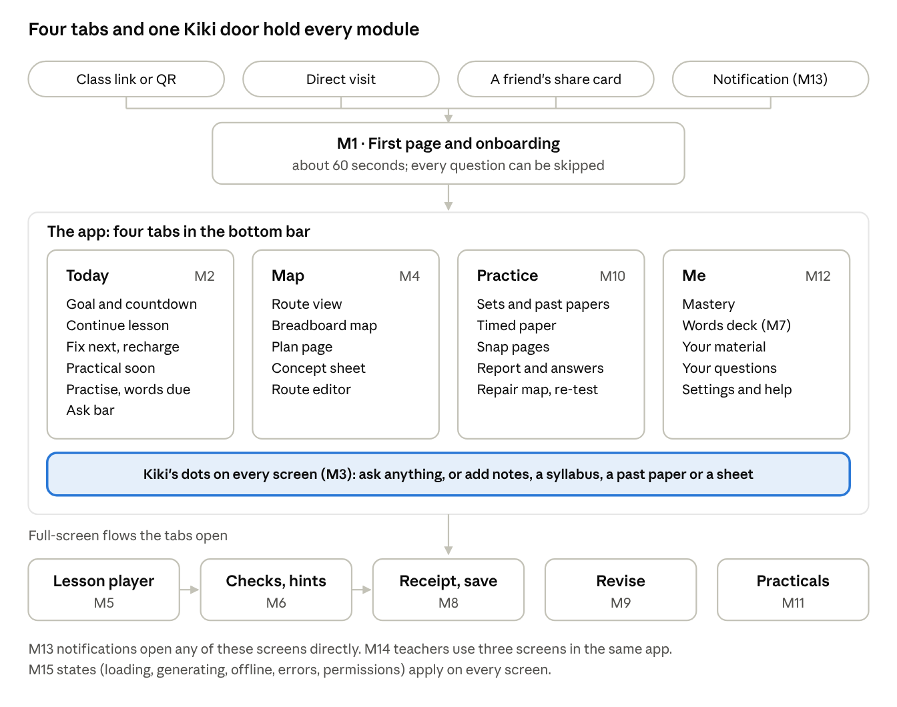
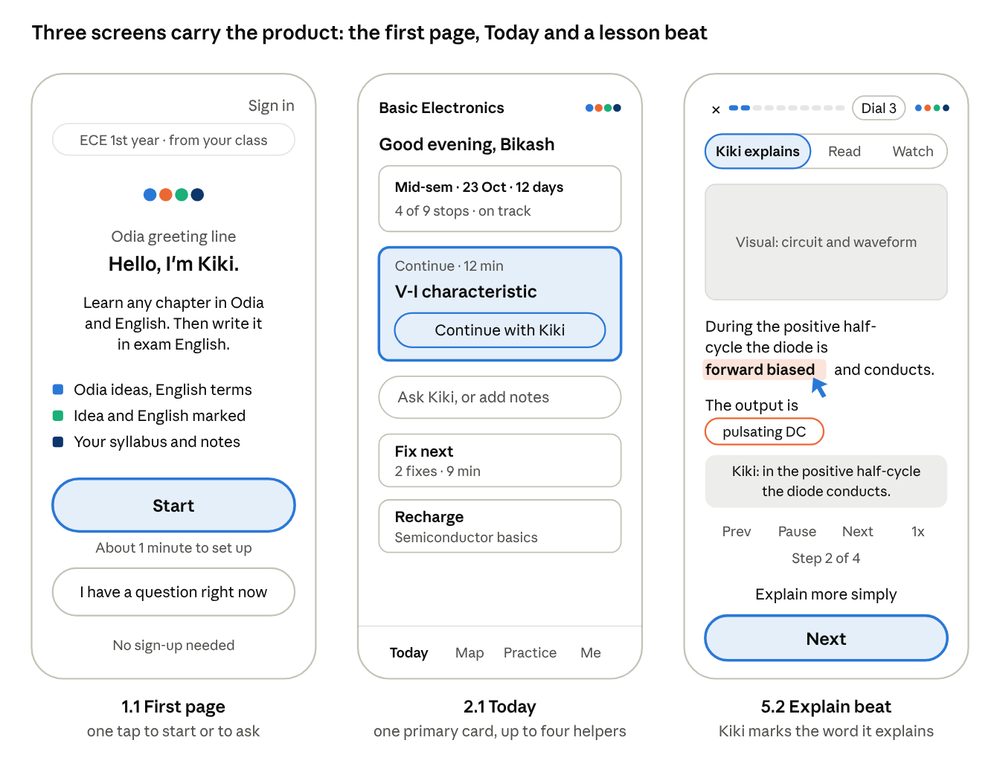
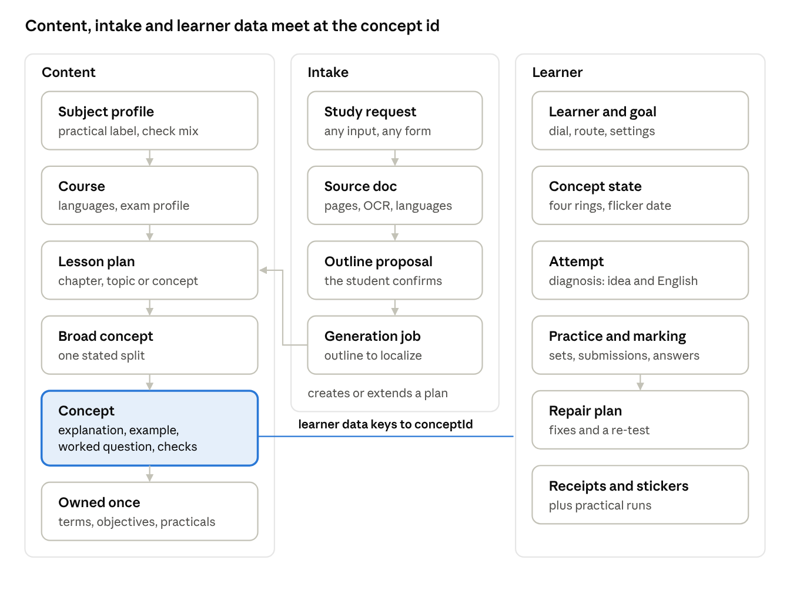
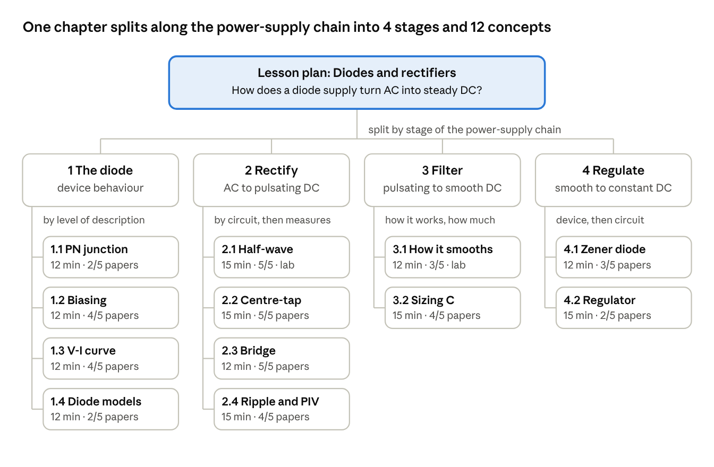

# Kikiland · Design Thinking

KiKi helps students overcome language barriers to entering STEM. The first audience is first-year engineering students who studied in Odia medium up to Class 12. KiKi teaches concepts in a student-controlled mix of Odia and English, keeps technical terms in English, and assesses concept understanding and English expression separately.

Kiki, the helper, is a companion cursor: it flies to the right part of the student's screen and shows the route one step at a time.



## Current hackathon focus

The team returned to the original STEM focus on 20 November 2026. The second mentor reinforced the choice to serve a specific student audience with a problem KiKi can solve and demonstrate. The decision and its file history are in the [scope cleanup ledger](docs/plans/kiki-scope-cleanup.md).

The current design case follows an Odia-speaking ECE student through Analog Modulation, with a draft phase-error tutor and a proposed DSB-SC lab in Simulink Online. The original rectifier prototype remains a clickable design reference.

| Area | State |
| --- | --- |
| Student journey | Confirmed language, assessment, and lab activation decisions |
| Analog Modulation | Chapter ledger and bilingual learning case are in the repo. Instructional content awaits review. |
| Phase-error tutor | The graph and routing examples pass structural checks. Native Odia review, ECE teacher review, and live app verification are pending. |
| Simulink Online | DSB-SC is the proposed lab. Tool access, model execution, and live guidance still need a trial. |

## What's in this repo

| Path | What it is |
| --- | --- |
| [`HANDOVER.md`](HANDOVER.md) | October design handoff and background references |
| [`docs/working-doc/`](docs/working-doc/) | October exports of the five-tab working doc |
| [`docs/diagrams/`](docs/diagrams/) | The working doc's diagrams as PNGs |
| [`data-model/`](data-model/) | Data model v2, subject profiles, four worked ledgers, validator and tests ([README](data-model/README.md)) |
| [`design-system/`](design-system/) | The Breadboard design system: `project/` (tokens, components, Kiki assets), `tools/build-kiki.js`, and the archived first Kiki set |
| [`prototype/`](prototype/) | The clickable mobile demo (`index.html`) and the Claude Design prompt |
| `AI_Builder_Cup_*.docx`, `Audio Transcript.txt` | The original inputs: product vision, technical architecture, team call |
| [`docs/archive/`](docs/archive/) | An early snapshot of the working doc, superseded |

### Reading order

1. [Odia ECE student journey](docs/ux/student-journey-odia-ece.md) for the confirmed learner flow.
2. [Analog Modulation learning case](data-model/ANALOG-MODULATION.md) for the lesson, assessments, and lab checkpoints.
3. [Phase-error tutor draft](docs/prototypes/ece-phase-error/README.md) and [Simulink lab recommendation](docs/ux/experiment-recommendation-simulink.md) for the worked example and open reviews.
4. [Backend source handoff](docs/backend-repo-setup.md) for the pinned context bundle and the starter’s `docs/plans/active.md`.

## Running things

The original demo runs in a browser, and the ledger and artwork scripts use Node 18 or later. The tutor validator uses Python.

```sh
# Validate every lesson ledger, plus the cross-ledger checks
node data-model/validate.js data-model/ledgers

# Seed 13 known errors and check the validator catches each one
node data-model/tools/test-validator.js

# Validate the ECE phase-error tutor draft
python -I docs/prototypes/ece-phase-error/validate_ece_graph.py docs/prototypes/ece-phase-error

# Regenerate Kiki's guide artwork (design-system/project/assets/Kiki/)
node design-system/tools/build-kiki.js

# Rebuild the diode ledger from the archived v1 file
node data-model/tools/migrate-v1-to-v2.js data-model/archive-v1/diodes-and-rectifiers.ledger.json data-model/ledgers/electronics/diodes-and-rectifiers.json
```

**The clickable demo:** open `prototype/index.html` in a browser. It loads React from a CDN, so it needs internet. Voice, camera and sign-in are simulated.

## Key decisions

- **Odia first, student in control.** A five-notch language dial that only the student moves; Kiki may suggest a notch.
- **Each colour represents a skill.** Green for concepts, red for technical words, yellow for academic English, and blue for practical application.
- **The X factor.** The student writes exam answers on paper and snaps them. Gemini reads the handwriting and marks the idea and the English separately, then builds a repair map of fixes.
- **The student's material comes first.** Their notes and syllabus are the first source of truth; curated content fills the gaps.
- **Reusable lesson model.** One lesson pyramid holds a chapter, a topic or a single question. KiKi matches a student's material before generating new content.
- **Progression and lab entry.** Concept checks require 60% and chapter tests 80%. Lab execution requires passing only the checks for the experiment's prerequisite concepts. The pointer activates after the student opens the software and the guidance connection is confirmed.

## Diagrams

| | |
| --- | --- |
|  |  |
|  |  |
|  |  |

## Live artifacts

These are private claude.ai artifacts owned by the project lead. Ask them to share access.

- Working doc (5 tabs): https://claude.ai/code/artifact/8ce032fe-a480-4582-85ab-0068f0f57a80
- Breadboard design system: https://claude.ai/artifact/2xtRepczwUyXaNVKP17cuc
- Clickable mobile demo: https://claude.ai/artifact/Xc4Xwxj943pPqT3DiAbziJ

## Notes

- All Odia text is placeholder and needs a native speaker's review.
- Past-paper weights in the diode ledger are sample values. The Chemical Engineering ledger's past papers are illustrative.
- Copy rules: short plain sentences, sentence case, no emoji, "not yet" instead of "wrong".
